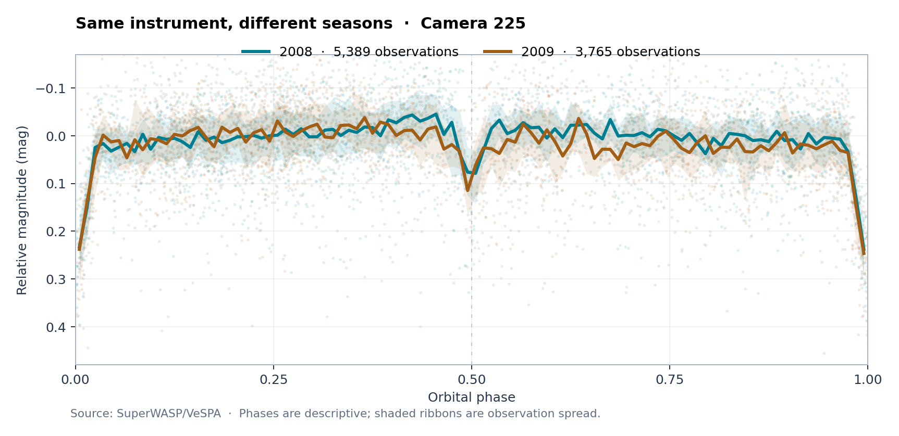
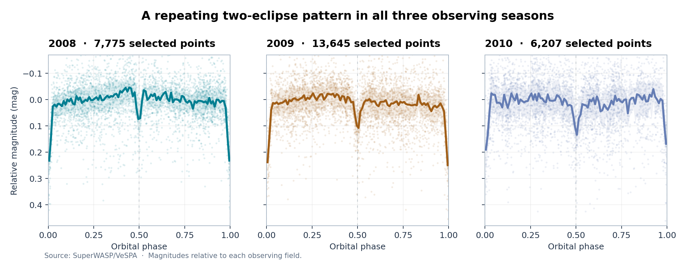
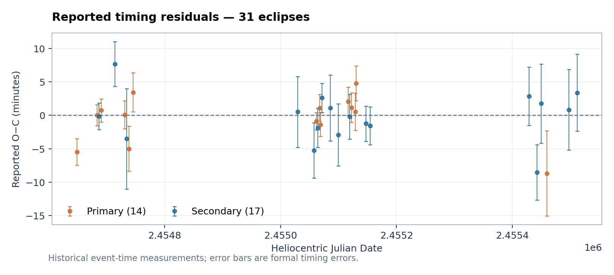

# 1SWASP J000342.76+014425.3

### SuperWASP photometric results · 2008–2010

**A detailed observational account of one eclipsing binary, using one archival source.** The primary comparison covers **the same SuperWASP camera (225) in 2008 and 2009**; a separate supplement presents the complete target-specific observations from **cameras 142 and 143 in 2010**.

> **Main result.** The target exhibits two unequal eclipses over an approximately **28.002-hour** full cycle. The main camera-225 comparison does **not** establish a significant intrinsic change in primary-eclipse depth from 2008 to 2009. Measurements from 2010 show seasonal differences, but their physical or instrumental cause remains unconfirmed.

## Study at a glance

| Observation | Result |
|---|---:|
| Target | **1SWASP J000342.76+014425.3** |
| VeSPA morphology | **EA/EB** |
| Approximate full two-eclipse period | **28.002 hours** |
| Original source points | **33,081** |
| Quality-selected points | **27,627** |
| 2008 / 2009 camera 225 measurements | **5,389 / 3,765** |
| 2010 points from cameras 142 / 143 | **1,985 / 4,222** |
| Historical individual eclipse times | **31** |

## Key observations

**2008–2009: one instrument.** Camera 225 recorded the same target in both seasons. Its reported local primary-eclipse depths are **0.1402 mag** (2008) and **0.1346 mag** (2009). The observed difference of **−0.0056 mag**, with a conditional 95% interval **[−0.0344, +0.0372] mag**, does not demonstrate an intrinsic change.

**2010: observations retained in full.** The FITS contains **8,122** measurements dated 2010; **6,207** meet the selected-quality criterion. Camera 225 does not appear in that year's target data; cameras 142 and 143 do. Both predicted eclipses were sampled, but individual primary eclipses have incomplete two-sided coverage. Seasonal depth estimates depend strongly on which reported observational summary is used.

## Read the publication

- **[Complete observational report (PDF)](docs/SCIENTIFIC_REPORT.pdf)** — publication-style, illustrated and fully in English.
- [Full report (Markdown)](docs/SCIENTIFIC_REPORT.md) — accessible online with linked figures.
- **[2010 observations (PDF)](docs/2010_SUPPLEMENT.pdf)** — cameras, both eclipses, seasonal findings and limitations.
- [2010 supplement (Markdown)](docs/2010_SUPPLEMENT.md).
- [Results catalogue](docs/RESULTS_CATALOGUE.md) — links to every included observational figure and data table.
- [Sources and rights](docs/SOURCES.md).

## More observational figures

| Eclipse depth by year | Individual eclipse timings |
|---|---|
|  |  |

## Data and status

The plotted measurements and the small published result tables refer to **this exact target**, not to other stars. Numeric summaries may reflect different published observational definitions and must not be treated as interchangeable quantities. A listed photometric difference is not proof of a change in stellar physics.

**No definitive cause is claimed** for the 2010 differences. The publication does not infer a third body, starspots, orbital precession, detached/semidetached geometry, or inaccurate instruments.

**Archive source:** [VeSPA target record](https://www.superwasp.org/vespa/source/1SWASPJ000342.76%2B014425.3/) · [Original FITS](https://www.superwasp.org/media/sources/1SWASPJ000342.76%2B014425.3/1SWASPJ000342.76014425.3.fits). Original FITS SHA-256: `1272399fceadc0486d9484ef5781a2b92284069b4dc4a29fea9fc8cb9e6486df`.

This repository distributes a **scientific-results presentation**—not survey-owned raw data or analysis software. See [rights and attribution](RIGHTS.md).
