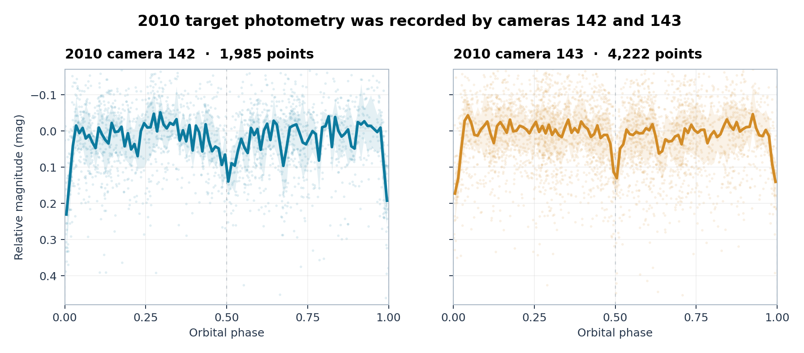
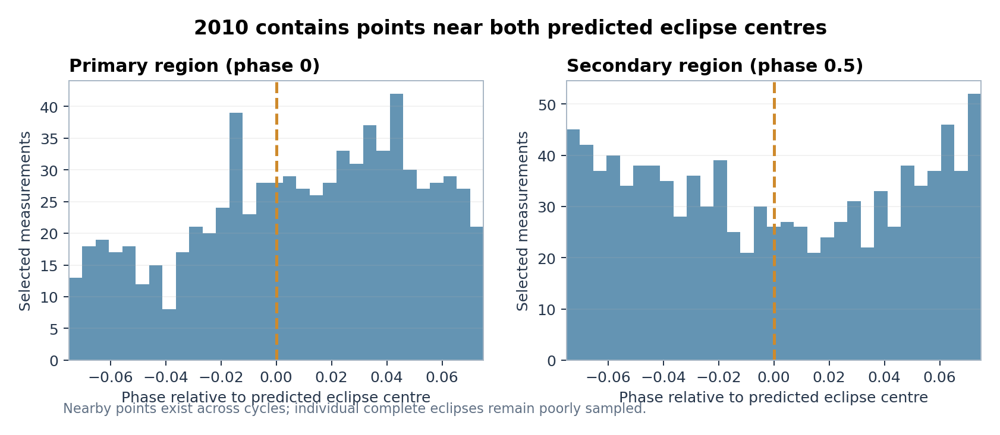
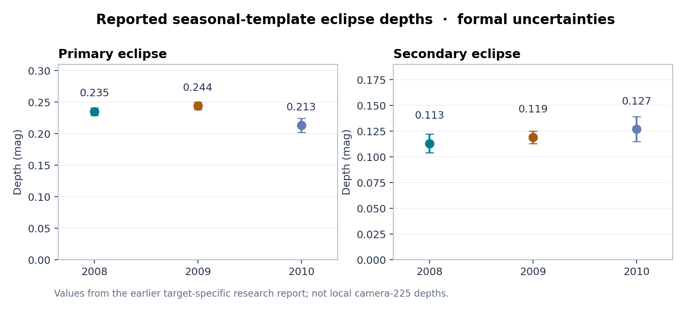
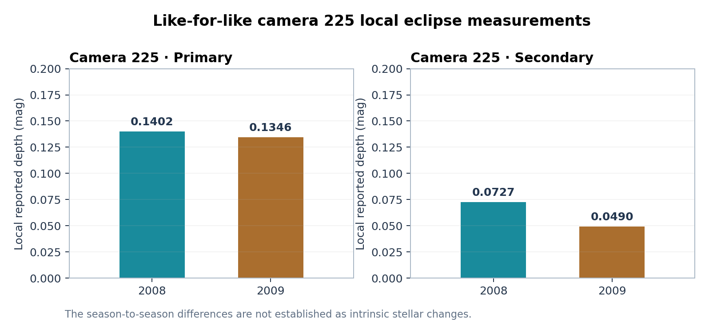
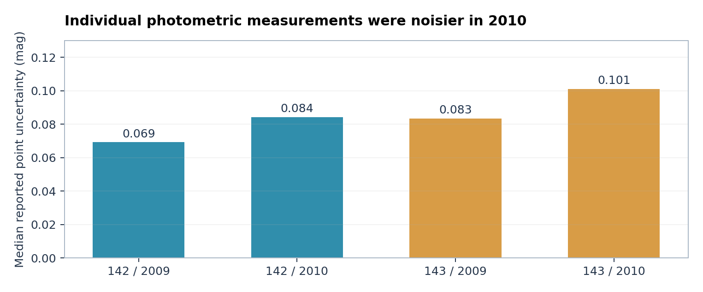
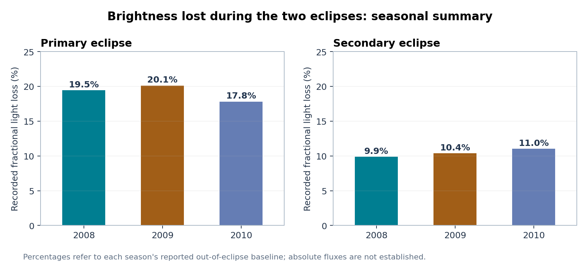

# 2010: complete observational results for 1SWASP J000342.76+014425.3

**SuperWASP/VeSPA · Supplement to the single-target observational report · 13 October 2026**

## Executive observational finding

The source was still recorded as an eclipsing binary with two recognisable minima in 2010. **There are no camera-225 observations of this target in the 2010 FITS records.** Instead, camera **142** contributed **2,855** original photometric points (1,985 in the selected sample) and camera **143** contributed **5,267** points (4,222 selected). The reason for the camera distribution is unknown from this source alone.

*Figure S1. Actual 2010 data of the same eclipsing binary, shown separately for the two observing cameras.*

## A. The source remains observable as a two-eclipse system

In the selected 2010 data, 61 measurements lie within 0.005 phase of the **predicted primary centre** and 47 near the predicted secondary centre. The nearest observations are approximately 0.000282 and 0.0000156 of an orbit from those predicted centres, respectively. Thus, it is incorrect to claim that the seasonal record entirely missed either eclipse. These points are distributed among different cycles; most separate events were incompletely sampled.

*Figure S2. Archival observation counts around each predicted centre, across the full 2010 season.*

## B. Seasonal-template depth values

These are reported global seasonal summaries, not direct measures of each star's physical radius or surface brightness.

| Year | Primary eclipse (mag) | Secondary eclipse (mag) |
|---|---:|---:|
| 2008 | **0.235 ± 0.006** | **0.113 ± 0.009** |
| 2009 | **0.244 ± 0.006** | **0.119 ± 0.006** |
| 2010 | **0.213 ± 0.011** | **0.127 ± 0.012** |

The nominal 2010 secondary depth is higher than the 2009 value by **0.008 mag**, but the associated difference is only about **0.60σ** under the stated simple formal-error approximation. **Secondary deepening is therefore not established.**

*Figure S3. The two historically reported eclipse-depth sequences. Point-error bars reflect the historical formal estimates.*

## C. Separately recorded camera-season depth values

| Camera | 2009 primary | 2010 primary | 2009 secondary | 2010 secondary |
|---|---:|---:|---:|---:|
| **142** | 0.245 ± 0.009 | 0.221 ± 0.016 | 0.127 ± 0.008 | 0.133 ± 0.020 |
| **143** | 0.245 ± 0.011 | 0.207 ± 0.014 | 0.113 ± 0.010 | 0.122 ± 0.014 |

Both cameras yield smaller *primary* central values in 2010, but they are not a fully independent physical validation because they share observing dates and may share environmental influences. These central values do not establish that the hardware was faulty.

## D. Distinct definitions of eclipse depth

The observed 2010 behaviour should not be reduced to a single percentage. Different observational summaries of the same archived light curve yield numerically different depths.

| Observational summary | Primary 2009 | Primary 2010 | Secondary 2009 | Secondary 2010 |
|---|---:|---:|---:|---:|
| **Global season profile** | 0.244 | 0.213 | 0.119 | 0.127 |
| **Pooled individual local events** | 0.1516 | 0.0938 | 0.0716 | 0.0548 |
| **Restricted local primary subset** | 0.1516 | 0.1532 | — | — |

The 2010 restricted local primary summary represents only **five separate observing nights**, and its observational selection was developed after examining the discrepancy. Its near agreement with 2009 is not a new demonstration of constancy; likewise, the pooled 0.0938 mag value is not proof that the physical eclipse weakened by 38%.

*Figure S4. Earlier local values for camera 225 in 2008–2009, shown as a separate reference series. Their scale must not be substituted for the global 2010 values.*

## E. Recorded instrument context

The selected 2010 measurements have higher median reported individual uncertainty than 2009 for **both** cameras:

| Camera | 2009 individual median error (mag) | 2010 (mag) | 2009 sky background proxy | 2010 proxy |
|---|---:|---:|---:|---:|
| 142 | 0.0692 | 0.0841 | 468.48 | 475.39 |
| 143 | 0.0833 | 0.1010 | 501.51 | 550.98 |

These are properties of the target's delivered records, not proof of a hardware replacement or a measured pixel-level background-noise model. The observing conditions or pipeline response may differ.

*Figure S5. The 2010 uncertainty level was greater in both available camera streams.*

## F. Brightness between the eclipses

The central 2010 differences between the two broad out-of-eclipse phase regions, expressed as the 0.75-region magnitude minus the 0.25-region magnitude, are **+0.01360 mag** for camera 142 and **+0.01300 mag** for camera 143. A separately reported adjusted estimate is **+0.00808 mag** with a conditional interval **[−0.00321,+0.01936] mag**. It includes zero. These observations alone do not identify spots or remove the possibility of instrumental effects.

Processed survey out-of-eclipse magnitude levels changed between 2009 and 2010 by roughly **−0.01293 mag** for camera 142 and **−0.00017 mag** for camera 143 (2010 minus 2009). Negative magnitude differences mean a higher nominal flux. They do not represent a reliable absolute calibration of the star across years.

## G. Light contamination, stellar activity and the observed uncertainties

With the central seasonal primary and secondary depths stated above, a restricted example involving constant additional light from a third source does not match *both* eclipse central values exactly, but its disagreement is too small and its observational error context too incomplete to reject this explanation. A variable stellar surface, blending, different camera responses and uneven temporal coverage remain distinct unresolved alternatives.

The historical combined-light magnitudes **B = 15.47** and **V = 14.23** imply **B–V = 1.24** for the source as catalogued in the original FITS header. The individual component colours, Gaia DR3 BP−RP, and camera-specific passband response curves have not been independently established here.

## H. Summary of what 2010 does and does not demonstrate

**Observed:** two minima remain recognizable, both predicted minima have nearby measurements, camera 225 contributes no 2010 target records, the two available cameras have different sampling and typical uncertainties, and multiple reported depth definitions yield season-dependent central values.

**Not observed as established physical facts:** a 38% decline in intrinsic eclipse depth, a secure secondary deepening, new stellar spots, an orbit-plane change, a third companion, a specific instrument failure, or a change of camera filters.

The 2010 data are retained as observations of **the same target**, rather than discarded or assigned an unverified explanation.

[Main report](SCIENTIFIC_REPORT.md) · [Results catalogue](RESULTS_CATALOGUE.md) · [Source record](https://www.superwasp.org/vespa/source/1SWASPJ000342.76%2B014425.3/)

## I. Relative light losses: an additional view of the same record

The season-referenced percentage of light lost during an eclipse is different from absolute stellar luminosity. It is useful as a descriptive summary but does not distinguish changes in the stars from differences in the delivered observation record.

*Figure S6. Relative primary and secondary flux losses in the published seasonal summaries. This comparison alone does not identify a physical mechanism.*
