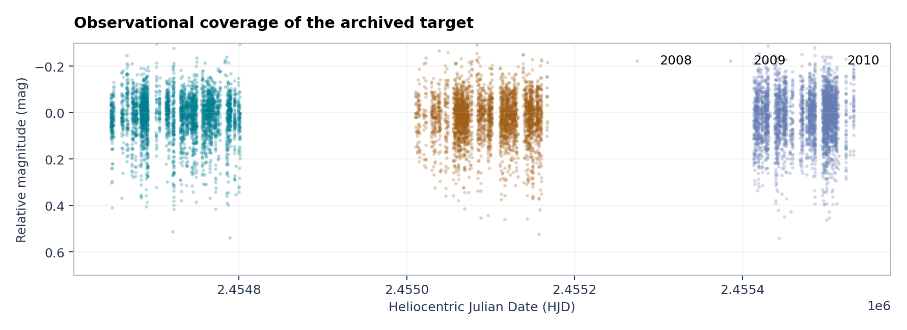

# Photometric results for 1SWASP J000342.76+014425.3

**SuperWASP archive  ·  2008–2010  ·  Single-target observational report  ·  13 October 2026**

## Abstract

The archived SuperWASP light curve of **1SWASP J000342.76+014425.3** contains 33,081 photometric records, with 27,627 measurements in the quality-selected observational sample. A repeating two-eclipse pattern is consistent with a full period of approximately **28.002 hours**, rather than the approximately 14-hour half-period listed with the “Half” flag in the VeSPA catalogue. The primary comparison uses **camera 225 in both 2008 and 2009**. Reported local primary depths of **0.1402 mag** and **0.1346 mag** do not provide evidence for a statistically established intrinsic change. The same archive also contains a substantial **2010** record from cameras 142 and 143. Its seasonal depth estimates differ under several observational summaries, but incomplete coverage, instrument differences and unmeasured correlated uncertainties preclude identifying a unique cause. All observations discussed here concern one and the same eclipsing binary. No novel physical effect is claimed.

*Figure 1. Two seasons from the same instrument. Points show quality-selected photometry, overlaid with a descriptive phase summary. The primary and secondary eclipses are readily distinguishable.*

## 1. The specific astronomical target

The SuperWASP designation is **1SWASP J000342.76+014425.3**, at the archived position RA **0.928194°** and Dec **+1.740369°**. The field contains an eclipsing system, observed as combined light from two stellar components. VeSPA records a morphological class **EA/EB** with automated candidate periods near **7 and 14 hours**; its 14-hour entry is marked **Half**. A complete two-eclipse sequence recurs after approximately **28.002 hours**.

The EA/EB designation describes a **light-curve morphology**, not a measurement of Roche geometry. Individual component temperatures, radii, mass ratio, inclination, Roche-lobe filling and third-light contributions are not established by these results.

## 2. Observation history

The provided FITS spans late 2006 through 2010. Only four 2006 points precede the well-populated seasons, and none pass the quality-selected comparison used here. The source contains 33,081 total photometric rows; the quality-selected data comprise 27,627 records at 22,431 distinct timestamps.

| Year | Camera | Original photometric points | Quality-selected points |
|---|---:|---:|---:|
| 2008 | 225 | 5,897 | 5,389 |
| 2008 | 142 | 2,670 | 2,386 |
| 2009 | 225 | 4,127 | 3,765 |
| 2009 | 142 | 6,720 | 5,147 |
| 2009 | 143 | 5,487 | 4,733 |
| 2010 | 142 | 2,855 | 1,985 |
| 2010 | 143 | 5,267 | 4,222 |

*Additionally, 54 original 2009 camera-144 rows and four 2006 camera-144 rows did not enter the quality-selected comparison.*

*Figure 2. Time distribution of the archived photometry of this exact target. The observational windows differ substantially across the seasons.*

## 3. The repeating binary light curve

The combined-light time series shows one stronger eclipse close to reference phase 0 and a weaker secondary eclipse near 0.5. Both are recognizable in the season-resolved view. Their differing depths imply unequal eclipsed contributions to the combined light, but they do not uniquely constrain temperatures, radii, separation or stellar geometry.

*Figure 3. The two-eclipse morphology is recognizable in 2008, 2009 and 2010. Individual plotted measurements show substantial observational scatter.*

Earlier recorded timings from **31 individual eclipses** span the populated observing seasons: **14 primary** and **17 secondary**. A formal fit to those already tabulated events gave **100,807.646 ± 0.146 seconds** (formal fit uncertainty only), consistent with the historical working period near **100,808 seconds**. No compelling secular period evolution was established.

*Figure 4. Reported O−C residuals of 31 historical eclipse timings. Formal measurement bars are not a complete uncertainty budget and do not demonstrate orbital decay or precession.*

## 4. Main result: camera 225 in 2008 and 2009

Camera **225** recorded the target in the same “SW0015+0312” field in both years. It contributed 5,389 quality-selected points in 2008 and 3,765 in 2009. This is the most directly comparable same-camera season pair in the available target archive.

| Recorded local quantity | 2008 | 2009 |
|---|---:|---:|
| Primary eclipse depth | **0.1402 mag** | **0.1346 mag** |
| Secondary eclipse depth | 0.0727 mag | 0.0490 mag |
| Independent observing nights contributing local primary estimates | 16 | 15 |
| Independent observing nights contributing local secondary estimates | 10 | 8 |

The recorded local primary-depth difference was **−0.0056 mag** (2009 minus 2008). Its exploratory 95% interval, **[−0.0344, +0.0372] mag**, includes zero. The local secondary-depth difference was approximately −0.0238 mag, with an exploratory interval also spanning zero. **Neither difference establishes an intrinsic stellar change.**

*Figure 5. Primary and secondary local eclipse measurements from the same camera. The plotted numerical contrast must not be interpreted as demonstrated physical evolution.*

## 5. Seasonal eclipse-depth results: all available cameras

A separate earlier summary of the full seasonal light curves gave the following values. **These global seasonal numbers and the camera-225 local measurements above describe different observational summaries. They must not be substituted for one another.**

| Season | Primary depth (mag) | Secondary depth (mag) |
|---|---:|---:|
| **2008** | 0.235 ± 0.006 | 0.113 ± 0.009 |
| **2009** | 0.244 ± 0.006 | 0.119 ± 0.006 |
| **2010** | 0.213 ± 0.011 | 0.127 ± 0.012 |

The primary eclipse is shallower in the 2010 seasonal central estimate than in 2009, while the secondary is slightly deeper in the *central value*. The secondary difference of **0.008 mag**, with an approximate combined formal uncertainty of **0.0134 mag**, is only about **0.60 standard deviations**. This is not evidence of a verified physical deepening.

*Figure 6. Formal seasonal-template estimates, including the distinct secondary eclipse. These are reported results, not a determination of the cause of any differences.*

## 6. Brightness between eclipses

The descriptive contrast between the two out-of-eclipse regions differs across season and camera. For camera 225, the recorded comparison between phase regions around 0.75 and 0.25 was approximately **+0.0019 mag** in 2008 and **+0.0219 mag** in 2009 under one descriptive definition. Different observational summaries give somewhat different values. The two regions were not observed together within a single night in the previously examined seasonal samples, so no unique astrophysical explanation follows from their contrast.

For 2010 the corresponding observed camera-specific central values were about **+0.0136 mag** (camera 142) and **+0.0130 mag** (camera 143). A separately reported adjusted central estimate of **+0.0081 mag** had an exploratory interval **[−0.0032,+0.0194] mag**. The interval encompasses zero. These readings neither establish nor exclude stellar spots.

## 7. The full 2010 observational season

The original 2010 record includes **8,122 measurements**, of which **6,207** are in the reported selected data. Unlike 2008 and 2009, **camera 225 contributes no target records in 2010**. The season consists of camera **142** (2,855 original; 1,985 selected) and camera **143** (5,267 original; 4,222 selected). The reason for this camera coverage is not documented in the target FITS.

*Figure 7. Observed 2010 light curves from both cameras. The same two eclipses are recognizable, but the scatter and relative shape differ between the recorded datasets.*

Multiple descriptions of local eclipse depth give different central estimates. In one earlier all-event local summary the primary eclipse values for 2009 and 2010 were **0.1516** and **0.0938 mag**. A later quality-restricted summary yielded **0.1532 mag** for 2010, but only **five independent nights** remained. These numbers are **not measurements of a single parameter under identical observational conditions**, and they cannot prove a 38% physical change.

The strict 2010 sample includes **61 measurements within ±0.005 phase** of the predicted primary-eclipse centre and **47** near the predicted secondary centre. This confirms that the *combined dataset* includes observations near both expected minima. It does not imply complete observation of both wings of any given individual primary eclipse; under the reported event-level coverage criterion no 2010 primary event had well-measured wings on both sides.

*Figure 8. Presence of points near both predicted centres. No individual well-bracketed primary eclipse is claimed on this basis.*

Median reported single-point photometric uncertainties were approximately **0.069** to **0.084 mag** for camera 142 and **0.083** to **0.101 mag** for camera 143 from 2009 to 2010, respectively. Median sky-background proxies rose modestly, especially for camera 143. These values indicate differences in the recorded observational conditions, not a proven hardware failure or pixel-level background RMS.

*Figure 9. A higher typical single-point uncertainty appears in the 2010 records for both cameras. It does not independently identify the physical cause of the eclipse-depth differences.*

## 8. Physical alternatives and present limits

The source is a combined-light eclipsing binary with unequal eclipses. Candidate explanations for season-dependent differences include variable stellar surface brightness, blended background or physically associated light, sampling and changes in observational conditions. No unique mechanism is supported by the current target-only photometry.

Under a restricted constant-additional-light comparison, the 2009-to-2010 primary central estimates correspond to about **13%** added light relative to the chosen 2009 reference baseline. That numerical scenario predicts a secondary depth near **0.105 mag** rather than the 2010 global central estimate of **0.127 mag**, yet its difference from the reported measurements does **not** statistically exclude that explanation. Such percentage values should not be treated as independently calibrated physical flux changes.

The archived FITS header reports **B = 15.47** and **V = 14.23** (combined-light historical values), giving **B−V = 1.24**. This is not a Gaia DR3 colour measurement or a measurement of individual component temperatures.

**Conclusion:** the reported orbital pattern and observation counts are secure for the archived data. Seasonal differences deserve specialist attention but cannot be uniquely assigned to stellar activity, observational calibration or contamination. In particular, the 2010 measurements should be neither discarded as erroneous nor presented as proof of unusual stellar evolution.

## 9. Source attribution and published material

The input is the official SuperWASP/VeSPA FITS **1SWASPJ000342.76014425.3.fits**, 3,254,400 bytes, SHA-256 **1272399fceadc0486d9484ef5781a2b92284069b4dc4a29fea9fc8cb9e6486df**. It is not embedded or redistributed in this repository. Published source observations retain their original terms.

The small numerical tables in [tables/](../tables/) preserve the reported target-specific outcomes, with an accompanying [2010 observations supplement](2010_SUPPLEMENT.md). The publication contains no non-source stellar catalogue values presented as independently reobserved quantities.

**References:** [VeSPA object page](https://www.superwasp.org/vespa/source/1SWASPJ000342.76%2B014425.3/); [Butters et al. 2010](https://doi.org/10.1051/0004-6361/201015655); [NASA SuperWASP data documentation](https://exoplanetarchive.ipac.caltech.edu/docs/SuperWASPProcessing.html); [VeSPA archive overview](https://arxiv.org/abs/2111.08494).

## 10. Overview of the light lost in each eclipse

The earlier global seasonal depth values can also be presented as the percentage of the seasonally referenced out-of-eclipse light obscured in each event. This is a *relative* reading, not a measure of the stars' absolute luminosities.

*Figure 10. Reported relative flux-loss percentages for the primary and secondary eclipses in 2008, 2009 and 2010. The apparent changes do not establish the underlying cause.*

The reported 2009 primary and secondary losses were approximately **20.13%** and **10.38%** of their reference out-of-eclipse flux. For 2010, the corresponding central values were **17.81%** and **11.04%**. The latter small increase was not statistically established.
